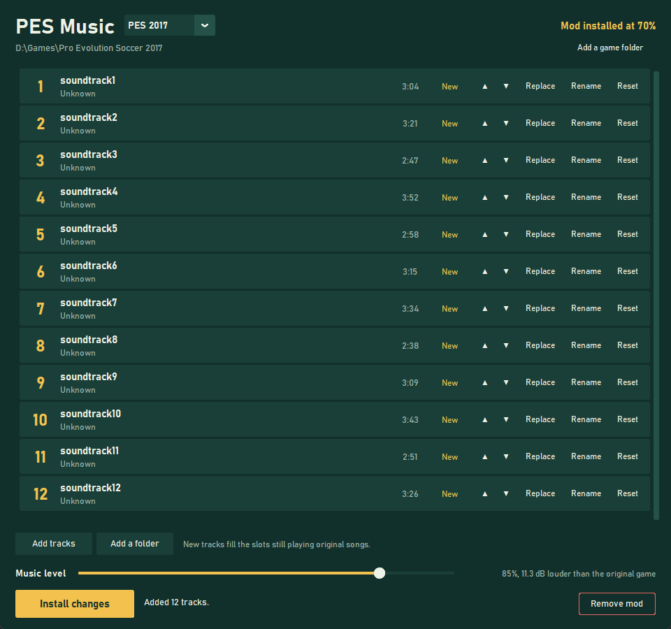

# PES Music

Put your own songs in the menu of Pro Evolution Soccer on PC, and fix its quiet menu music.

| Game | Menu songs | Music level |
|---|---|---|
| PES 2016 | 12 | Not available |
| PES 2017 | 12 | Yes |
| PES 2019 | 24 | Yes |
| PES 2020 | 25 | Yes |
| eFootball PES 2021 | 25 | Yes |

You need your own copy of the game on PC. No game files or music are included.

## Get started

1. Download `PESMusic.exe` from [Releases](../../releases). Windows may warn you because the app isn't signed.
2. Close the game and open the app. It finds your games, or use **Add a game folder**.
3. **Add tracks** or **Add a folder**, then click **Install mod**.

Name your files `Artist - Title.mp3` to get the right names automatically. MP3, FLAC, WAV, M4A, OGG and Opus work.

If FFmpeg is missing, the app offers to install it with winget. You can also put `ffmpeg.exe` and `ffprobe.exe` in a `tools` folder next to the app.

## Using it

- **Replace** swaps one song, **Rename** changes the title and artist shown in the game, and **Reset** brings the original back. The arrows change the order.
- **Install changes** applies everything. Slots you didn't touch keep their songs.
- **Remove mod** takes the mod out and puts the game back as it was.

## Good to know

- Your game files aren't changed. The mod lives in the game's `download` folder, next to any DLC.
- Other mods keep their place in `DpFileList.bin`, which is backed up first. If another mod changes the menu music, the app warns you.
- Long names are shortened to the longest the game is known to show, because PES 2017 crashes on very long ones.
- In-match music isn't changed.
- If something goes wrong, details are in `%LOCALAPPDATA%\PESMusic\app.log`.

## Building

Needs Python 3.12. Run `build.ps1`, and the app lands in `dist\PESMusic.exe`.

Run the tests with `python -m unittest discover tests`, with `src` on `PYTHONPATH`. `tests\game_scenarios.py` runs full installs on temporary copies of your games.

How the mod works is in [docs/how-it-works.md](docs/how-it-works.md).

## Credits

Audio conversion uses [VGAudio](https://github.com/Thealexbarney/VGAudio) by Alex Barney (MIT license, in `tools`) and [FFmpeg](https://ffmpeg.org), which is installed separately.

Not affiliated with or endorsed by Konami. Pro Evolution Soccer and PES are trademarks of Konami Digital Entertainment.

## License

MIT. See [LICENSE](LICENSE).
